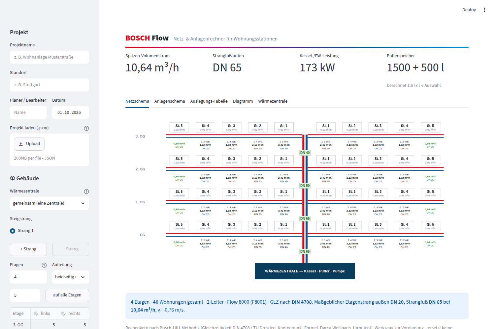

# bosch-flow

Netz- & Anlagenrechner für Wohnungsstationen (Flow 8000 / Flow 7000): Gleichzeitigkeit nach DIN 4708 bzw.
TU Dresden, Rohrdimensionierung je Strang, Wärmezentrale (Kessel-/FW-Leistung, Pufferspeicher nach
Bosch-HIU-Methodik) und DLE-Auslegungshilfe (Flow 7000 HPS).



Es gibt zwei Versionen mit identischem Rechenweg:

| | `index.html` (V54) | Python / Streamlit |
|---|---|---|
| Start | Datei im Browser öffnen, läuft offline | `streamlit run app.py` |
| Oberfläche | Original mit Canvas-Schemata | gleicher Aufbau: Eingabekarten ①②③ links, Ergebniskarten rechts |
| Sicherung | automatisch im Browser | automatisch im Browser + „Zwischenspeichern“, Wiederherstellen beim Öffnen |
| Hell/Dunkel | Schalter ☾/☀ | Schalter ☾/☀ in der Kopfzeile |
| Export | PDF (Druck), Projekt-JSON | PDF-Auslegungsbericht, Projekt-JSON, Excel |
| Projektdateien | `.json` | dasselbe `.json`-Format, in beide Richtungen austauschbar |

## Python-Version starten

```bash
python -m venv .venv
source .venv/bin/activate        # Windows: .venv\Scripts\activate
pip install -r requirements.txt
streamlit run app.py
```

Die App öffnet sich unter <http://localhost:8501>.

## Bedienung (Kurzüberblick)

- **Kachel-Dashboard:** Oben vier Kennzahlen (Volumenstrom, Anschluss, Erzeuger, Puffer, mit Trend zur letzten
  Änderung), darunter 3D-Gebäude, Prüfungen (Ampel), Variantenempfehlung, Strom-Gleichzeitigkeit nach DIN 18015-1,
  Rohrnetz, Wohnungsstation und Stückliste.
  Ein Klick auf eine Kachel öffnet die Details (Schemata, Tabellen, Herleitungen, Diagramme).
- **Eingaben:** Panel links mit den Reitern Gebäude · System · Auslegung · Hydraulik · Projekt, ein-/ausblendbar über
  „Eingaben“. PDF oben rechts, Speichern/Laden/Excel/Zurücksetzen im Menü „···“.
- **Druckverlust, Pumpe & Rohrmengen (Erweiterung über V54):** Reiter „Hydraulik“ mit Geschosshöhe, Stations- und
  Strangabständen, Zuschlag Einzelwiderstände und Ansatz Wärmezentrale. Daraus: Druckverlust je Abschnitt im gewählten
  Rohr (Darcy-Weisbach, λ wie im HIU-Kern), ungünstigster Fließweg, Förderhöhe inkl. Primär-Δp der Station laut
  Katalog, Prüfung gegen Netzpumpenmodul NM 3/6/10 (0,8 bar Restförderhöhe) und Rohrmengen je Nennweite mit
  Wasserinhalt. Auch in PDF (eigene Seite), Excel (Blatt „Hydraulik“) und Stückliste.
- **Sicherung:** Jede Eingabe wird automatisch im Browser gesichert und beim nächsten Öffnen wiederhergestellt
  (auch nach dem Hell/Dunkel-Umschalten). „Zwischenspeichern“ sichert sofort; „Speichern“ lädt eine Projektdatei
  (.json) herunter, die auch die HTML-Version öffnet. Die Browser-Sicherung bleibt im jeweiligen Browser.
- **Netzschema:** Mit der Maus über Stationen und DN-Marken fahren – zeigt WE, Gleichzeitigkeit, Volumenstrom, Rohr,
  Geschwindigkeit, Druckverlust und Status. DN-Farbe: grün = OK, orange = grenzwertig, rot = über v_max.
  „📌 Anheften“ hält das Schema beim Scrollen sichtbar.
- **Alle Stränge:** Netztopologie mit Regler für die Position der Wärmezentrale (wird mitgespeichert), „⤢ Vollbild“,
  Hauptstrang je Abschnitt mit maßgeblichem Abschnitt, Gesamt-Kennzahlen und Diagramme.
- **3D-Gebäudemodell:** Das ganze Rohrnetz als drehbares Raummodell – Keller mit Hauptstrang und Wärmezentrale,
  Steigrohre, Etagenleitungen und Stationen. Rohrdicke = Nennweite, Farbe = Ausnutzung von v_max oder Nennweite;
  jedes Rohrstück zeigt beim Überfahren seine Werte. Ganzes Projekt oder nur der aktuelle Strang, auch im Vollbild.
- **Variantenvergleich:** Rechnet dieselbe Planung mit anderem Rohrmaterial, Vorlauf, Station, Zentrale,
  Gleichzeitigkeit und Leitersystem durch, bewertet (Rohrnetz, Erzeuger, Puffer, v_max) und empfiehlt die beste
  Auslegungsvariante – mit einem Klick übernehmen und rückgängig machen. Auch im PDF-Bericht.
- **Gerät & Stückliste (Katalog März 2026):** Unter ② wählt man Montage (Auf-/Unterputz, Thermentausch RS) und
  Heizkreis (ungemischt/gemischt). Die App zeigt die passende Station mit Produktbild, Bestell-Nr., UVP und den
  Katalogdaten am gewählten Vorlauf (Primär-Volumenstrom, Primär-Druckverlust, Mindest-/Höchstvorlauf) samt
  Katalog-Hinweisen. Die Stückliste (App, PDF, Excel) enthält Stationen, Montage- und Regelungszubehör,
  thermischen Bypass, Netzpumpenmodul NM 3/6/10 und Inbetriebnahme. Der Rechenkern V54 bleibt unverändert.
- **PDF:** „Planung als PDF exportieren“ erzeugt den Auslegungsbericht (A4 quer) mit allen Schemata und Tabellen.

## Streamlit Cloud

Repository `sommer-nt/bosch-flow`, Branch wählen, Main file `app.py`. `requirements.txt` und `packages.txt`
(Schrift für Umlaute im PDF) werden automatisch installiert. Optional unter **Settings → Secrets** ein Passwort
setzen (Vorlage: `.streamlit/secrets.toml.beispiel`):

```toml
APP_PASSWORT = "..."
```

## Aufbau

```
app.py                  Streamlit-Oberfläche (Aufbau wie index.html)
browser.py              Auto-Sicherung im Browser (localStorage) und Hell/Dunkel-Schalter
bosch_flow/
  data.py               Datenbasis (Rohrreihen, Stationen, DIN 4708, Puffergrößen …)
  calc.py               Rechenkern – 1:1 aus index.html übertragen
  report.py             Tabellen, Herleitungstexte, Excel-Export
  schemata.py           Netzschema, Netztopologie, Anlagenschema (wie die Canvas-Zeichnungen der HTML)
  zeichnung.py          Zeichenschicht: dieselbe Grafik für Bildschirm (Plotly) und PDF
  bericht.py            PDF-Auslegungsbericht (A4 quer, wie „Planung als PDF exportieren“)
  plots.py              Diagramme (Plotly)
  modell3d.py           3D-Gebäudemodell des Rohrnetzes (Plotly)
  varianten.py          Variantenvergleich mit Bewertung und Empfehlung
  hydraulik.py          Druckverlust, Förderhöhe, Pumpenprüfung, Rohrmengen (Erweiterung)
  katalog.py            Gerätedaten, Bestell-Nr., Netzpumpen, Stückliste (Bosch Katalog 03/2026)
  daten/produkte/       Produktbilder (freigestellt) und Systemprinzip aus dem Katalog
  daten/icons/          Piktogramme: Erzeuger, Puffer, Heizkreis (aus der HTML) + Pumpe, Trinkwasser, Station
  project.py            Projektdateien laden/speichern (kompatibel mit index.html)
tests/
  scenarios.json        15 Prüffälle (2-/4-Leiter, DLE, manuell, Mehrstrang, Hochhaus …)
  golden.json           Referenzwerte, direkt aus index.html berechnet
  test_calc.py          vergleicht Python mit den Referenzwerten
tools/make_golden.py    erzeugt golden.json neu aus index.html (Headless-Chromium)
```

Den Rechenkern kann man auch ohne Oberfläche nutzen:

```python
from bosch_flow import Inputs, Strang, compute

R = compute(Inputs(glz="tud", mat="kupfer"), Strang.new(floors=4, split="both", seed=5))
print(R["vRows"][0]["dim"], R["anlage"]["kesselQ"], "kW")
```

## Tests

```bash
pip install -r requirements-dev.txt
pytest
```

Die Tests prüfen alle Zwischen- und Endwerte (Volumenströme, Dimensionen, Geschwindigkeiten, Druckverluste, Hauptstrang je Position der Wärmezentrale,
Kessel, Puffer, DLE-Tabelle, Herleitungstexte) gegen die HTML-Version. Wenn `index.html` geändert wird,
die Referenzwerte mit `python tools/make_golden.py` neu erzeugen und die Abweichungen prüfen.

---

Werkzeug zur Vorplanung – ersetzt keine verbindliche Rohrnetzberechnung. Prüfung obliegt Planer, Installateur
oder Bauherr. Entwickelt von Daniel Sommer · HC/SDE3-PSD.
